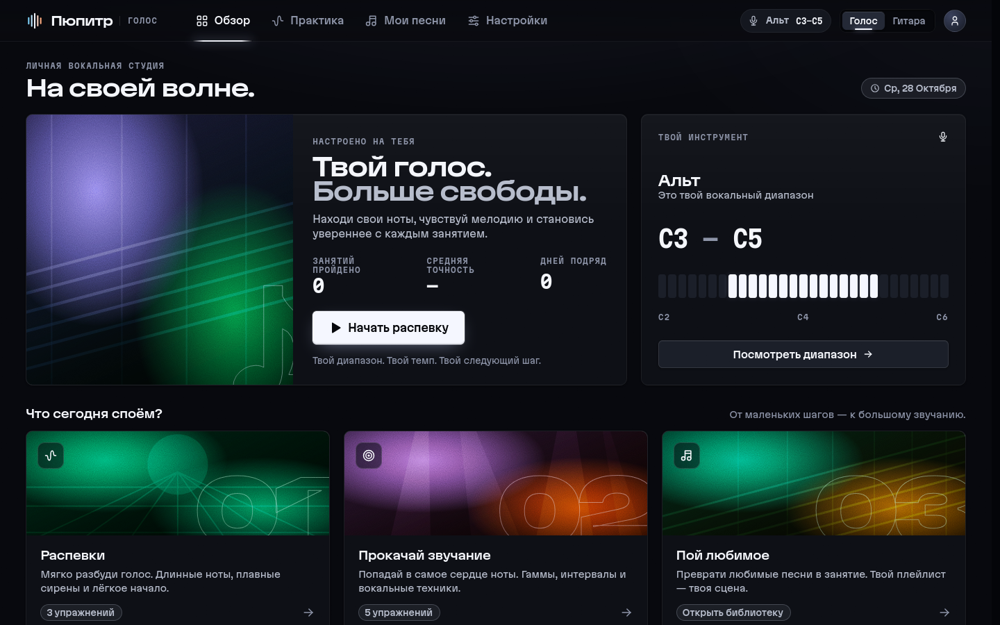
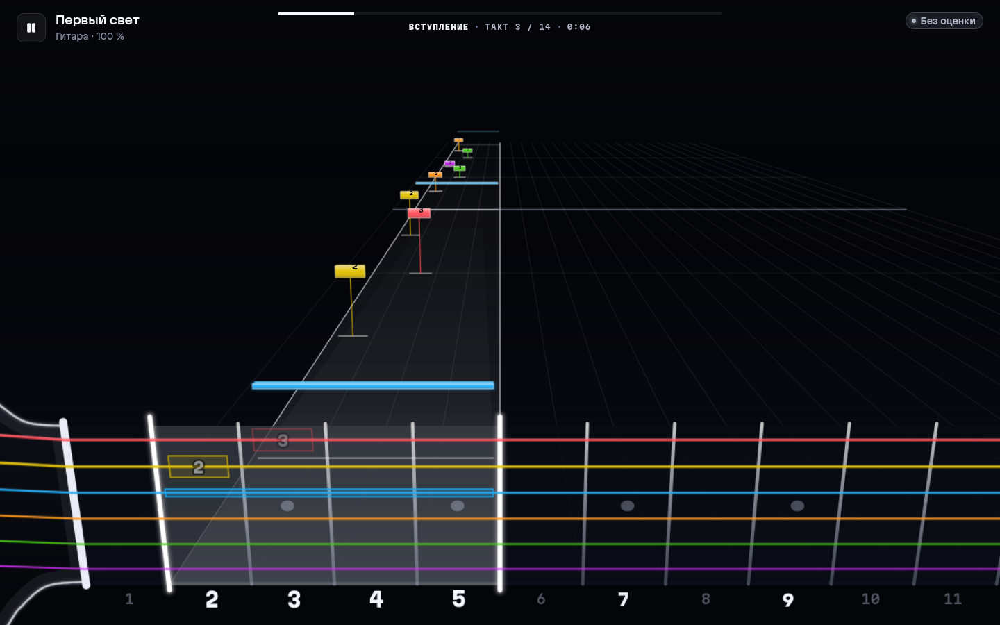

# Pupitre

[English](README.md) · **Русский**

**Pupitre** — тренажёр для голоса и гитары. Поёшь в микрофон или играешь на гитаре, приложение в реальном времени слышит
ноты и показывает, попал ли ты. Работает в браузере и как десктоп-приложение (Linux, Windows).

| Голос | Гитара |
|---|---|
|  |  |

## Возможности

**Голос**
- Мастер диапазона за минуту: упражнения и песни подстраиваются под твой голос.
- Распевки и упражнения (длинные ноты, сирены, гаммы, интервалы, вибрато) генерируются под твой диапазон; темп,
  тональность и повторы настраиваются.
- Свои песни: загрузи mp3/wav/flac — сервер отделит вокал (Demucs), снимет мелодию (pYIN) и сдвинет её в твою октаву.
  Петь можно под минус, с оригиналом или с одним вокалом; ноты правятся в редакторе.
- Лента голоса и пиано-ролл, техники (вибрато, расщепление), очки, серия, итоги.

**Гитара**
- Импорт Guitar Pro (GP3–GP8, GPX) и MusicXML, 3D-дорожка летящих нот и табулатура.
- Минус синтезируется из партитуры (саундфонт MuseScore General), твоя партия звучит тихой подсказкой.
- Распознавание нот и аккордов с подсчётом очков: отклик на каждое попадание, «рано / поздно», «не та нота».
- Режим обучения: песня ждёт на каждой ноте, пока ты её не сыграешь.
- Экран «Вход и звук»: выбор интерфейса и канала, уровень, мониторинг. В десктопе для Linux — низколатентный
  нативный движок (JACK/PipeWire, ≈ 7 мс туда-обратно).

## Скачать

Готовые сборки для Linux (`.AppImage`) и Windows (установщик и portable `.exe`) — на странице
[Releases](../../releases). Их собирает и выкладывает локально `node tools/release.mjs X.Y.Z` (проверки, пакеты Linux и
Windows, тег и GitHub Release); workflow GitHub Actions в `.github/` сохранены, но отключены.

Распевки, упражнения и гитара работают сразу. Сервер обработки песен приложение разворачивает само при первом
открытии «Моих песен»: скачивает Python-окружение, зависимости (≈ 2,5 ГБ, один раз) и ffmpeg. Можно указать и
внешний сервер: «Настройки → Сервер обработки песен».

## Разработка

Нужны Node 22+, Rust (версия — в `rust-toolchain.toml`, цель `wasm32-unknown-unknown`), для песенного сервера —
Python 3.11+ и ffmpeg.

### Веб

```bash
cd apps/web
npm install
npm run build:dsp                  # DSP-ядро (Rust → WASM)
node ../../tools/soundfont/fetch.mjs   # саундфонт синт-минуса гитары (≈ 40 МБ, не хранится в git)
npm run dev                        # http://localhost:5173
```

Микрофон браузер даёт только на `localhost` или по HTTPS.

### Песенный сервер

```bash
cd services/api
python3 -m venv .venv
.venv/bin/pip install torch torchaudio --index-url https://download.pytorch.org/whl/cpu
.venv/bin/pip install -r requirements.txt
.venv/bin/uvicorn app.main:app --port 8000
```

Dev-сервер веба проксирует `/api` на `127.0.0.1:8000`. Первый запуск Demucs скачает веса модели htdemucs. Без
torch/demucs сервер тоже работает — мелодия снимается с полного микса. На aarch64 (ARM-серверы) ставь
`demucs==4.0.1`: у 4.1 нет готовых колёс для этой платформы. Для доступа не с localhost задай
`PUPITRE_API_TOKEN` и `PUPITRE_ALLOWED_ORIGINS` (подробности — `services/api/README.md`).

### Десктоп

```bash
cd apps/desktop
npm install
npm run dev     # собирает веб, нативные модули (Linux) и запускает Electron
npm run dist    # пакеты в apps/desktop/release/
```

### Браузерная версия на своём сервере

`node apps/desktop/build-web.mjs` собирает `apps/web/dist` (вместе с саундфонтом). Для раздачи подойдёт любой
статический сервер с HTTPS; в `tools/deploy/static-https.mjs` — минимальный сервер без зависимостей, который ещё и
проксирует `/api` на песенный сервер.

## Структура

```
apps/web          веб-приложение (React + TypeScript + Vite): голос, гитара, дизайн-система «Рампа»
apps/desktop      Electron-оболочка, встроенный песенный сервер, мосты к нативным модулям
packages/dsp      DSP-ядро на Rust (YIN, техники голоса) → WASM и нативная библиотека
packages/engine   низколатентный звуковой движок гитары (Rust, JACK, N-API)
packages/native-audio  нативный захват голоса (Rust, cpal, N-API)
services/api      песенный сервер (FastAPI, Demucs, pYIN)
tools/gates       проверки сборки: бюджет бандла, исходники, лицензии, защита вокального режима
content           реестр лицензий шрифтов, иконок и саундфонтов
```

## Проверки

```bash
cd apps/web && npm test                    # юнит-тесты (vitest)
node tools/gates/check-build.mjs           # сборка + бюджет входного бандла
node tools/gates/check-sources.mjs         # правила исходников гитарного раздела
node tools/gates/check-licenses.mjs        # лицензии зависимостей и контента
node tools/gates/check-vocal.mjs --browser # вокальный режим не сломан (эталоны + e2e в Firefox)
```

Сквозные сценарии в Firefox и Electron лежат в `apps/web/e2e` и `apps/desktop/e2e` (см. `apps/web/e2e/lib/README.md`).

## Лицензия

[MIT](LICENSE). Сторонние компоненты и их лицензии — в [THIRD_PARTY_NOTICES.md](THIRD_PARTY_NOTICES.md).
